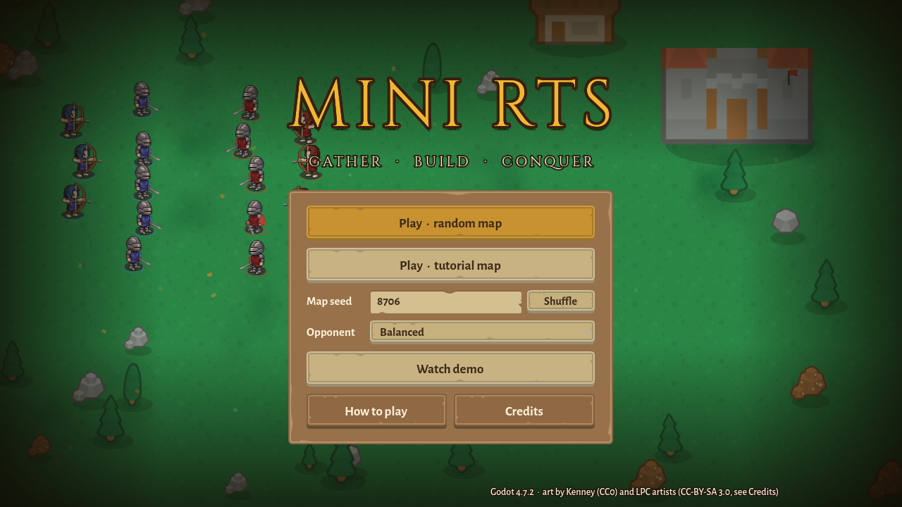
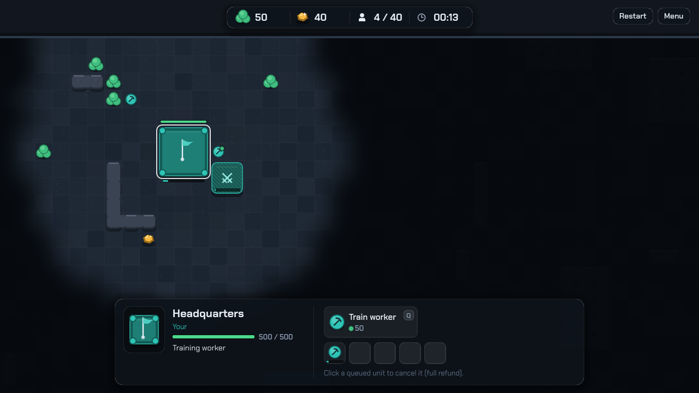
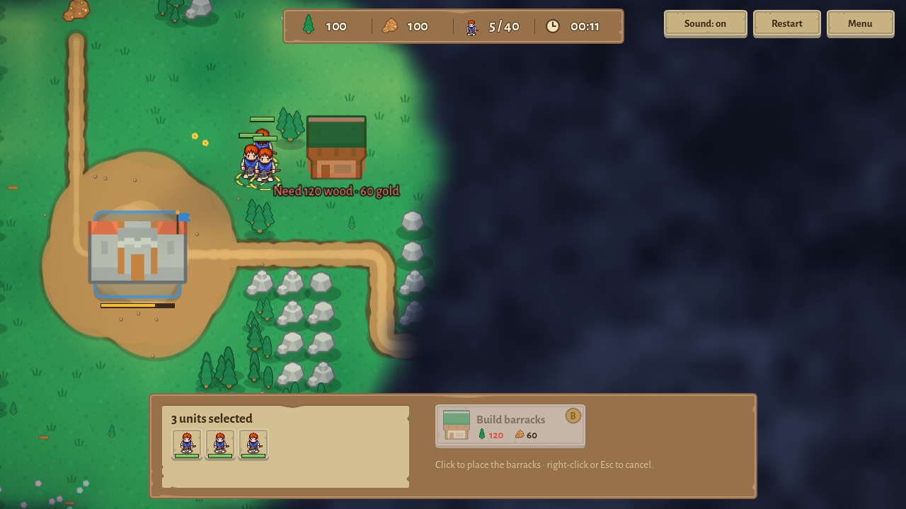
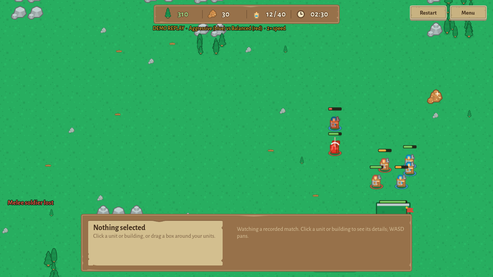
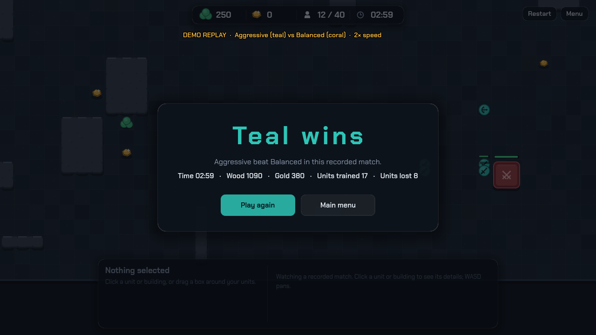

# Mini RTS

A small, complete real-time strategy game in **Godot 4.7.2**. Gather wood and gold, build a barracks, train soldiers, scout through the fog of war, and destroy the enemy headquarters before the AI destroys yours.

**Play it in the browser: <https://abhiramreddypasam18243-lab.github.io/mini-rts/>**
(or run it yourself in a container, below). The main menu also has **Watch demo**: a recorded match played back at 2× speed.

**On Streamlit:** the same game in a Streamlit page: `streamlit/streamlit_app.py` (deploy on [share.streamlit.io](https://share.streamlit.io): this repository, branch `main`, main file `streamlit/streamlit_app.py`). Run it locally with `pip install -r streamlit/requirements.txt` and `streamlit run streamlit/streamlit_app.py`.

**As an app:**
- **Install the web app:** open the link in Chrome or Edge and click the *Install* icon in the address bar (or *⋮ → Install Mini RTS*). It opens in its own window with its own icon and works offline after the first load.
- **Windows download:** [Releases page](https://github.com/abhiramreddypasam18243-lab/mini-rts/releases/latest) → download `MiniRTS-windows-x64.zip`, unzip, double-click `MiniRTS.exe` (one file, nothing to install). Windows SmartScreen may warn because the file is not code-signed: click *More info → Run anyway*.



| | |
| --- | --- |
|  |  |
|  |  |

The game is built on one idea: **all the rules live in a deterministic simulation that knows nothing about graphics.** The Godot scenes only draw what the simulation says and turn clicks into commands. So every rule can be tested without a window, matches can run headless about 200 times faster than real time, a match can be replayed exactly from its command log, and two AI strategies can be compared over hundreds of matches. The full specification is [`SPEC.md`](SPEC.md).

## Contents

1. [Quick start](#quick-start)
2. [Setup from a clean checkout](#setup-from-a-clean-checkout)
3. [Controls](#controls)
4. [How it is built](#how-it-is-built)
5. [Units, buildings and balance](#units-buildings-and-balance)
6. [How A* finds paths](#how-a-finds-paths)
7. [How the enemy AI thinks](#how-the-enemy-ai-thinks)
8. [The strategy experiment](#the-strategy-experiment)
9. [Tests](#tests)
10. [Deployment](#deployment)
11. [Known limitations and simplifications](#known-limitations-and-simplifications)
12. [Documents](#documents)

## Quick start

**Online:** open the link above.

**With Docker** (the only thing you need installed):

```bash
git clone https://github.com/abhiramreddypasam18243-lab/mini-rts.git
cd mini-rts
docker compose up -d
```

Then open <http://localhost:8080>. The first build downloads Godot and its web templates (about 1.3 GB, checked against the official SHA-512 sums), so it takes a few minutes; later builds are cached. `docker compose down` stops it.

**From another device on your network** (phone, tablet, second laptop): open `http://<this-computer's-LAN-IP>:8080`. Find the IP with `ipconfig` (Windows) or `ip addr` (Linux). On Windows you may need:

```powershell
# Run PowerShell as Administrator.
# 1. Allow port 8080 through the Windows firewall:
New-NetFirewallRule -DisplayName "Mini RTS 8080" -Direction Inbound -Protocol TCP -LocalPort 8080 -Action Allow
# 2. Only if Docker runs inside WSL (not Docker Desktop): forward the port into WSL.
$ip = (wsl hostname -I).Trim().Split(" ")[0]
netsh interface portproxy add v4tov4 listenport=8080 listenaddress=0.0.0.0 connectport=8080 connectaddress=$ip
```

*Second-device check (AC-84):* pending: record the date and result here after trying it.

## Setup from a clean checkout

You need **Godot 4.7.2-stable** (the pinned version) and, for the web build, its export templates. GUT 9.6.1 (the test framework) is already in `addons/gut/`.

1. **Install Godot 4.7.2.** Download it from <https://github.com/godotengine/godot/releases/tag/4.7.2-stable> (Linux: `Godot_v4.7.2-stable_linux.x86_64.zip`; Windows: `Godot_v4.7.2-stable_win64.exe.zip`). Check it with `godot --version` → `4.7.2.stable.official`.
2. **Install the web export templates** (only for exporting): from the same page, `Godot_v4.7.2-stable_export_templates.tpz`. In the editor: *Editor → Manage Export Templates → Install from File*. Headless (Linux): unzip `templates/web_nothreads_*.zip` and `templates/version.txt` into `~/.local/share/godot/export_templates/4.7.2.stable/`.
3. **Run the tests** (headless, no window):
   ```bash
   GODOT=/path/to/godot tools/run_tests.sh          # fast suite, about 20 s
   GODOT=/path/to/godot tools/run_tests.sh --long   # full counts, about 20 min
   ```
4. **Run the game:** `godot --path .` (or open `project.godot` in the editor and press F5).
5. **Export the web build:** `mkdir -p build/web && touch build/.gdignore && godot --headless --export-release "Web" build/web/index.html` (the folder must exist; `.gdignore` stops Godot importing its own output)
6. **Start the container:** `docker compose up -d --build`, then open <http://localhost:8080>.

Other tools:

```bash
# 200 headless matches between two AI policies -> CSV (SPEC 8)
godot --headless --script res://tools/run_matches.gd -- --policy-a aggressive --policy-b balanced --seeds 1-100 --out results.csv
# Experiment tables from CSVs
godot --headless --script res://tools/analyze.gd -- --out docs/experiment-tables.md docs/experiment/*.csv
# Re-record the demo replay
godot --headless --script res://tools/make_demo.gd -- data/replays/demo.replay.jsonl
# Windows desktop build (needs the windows_release_x86_64 template from the same .tpz)
mkdir -p build/windows && godot --headless --export-release "Windows Desktop" build/windows/MiniRTS.exe
# Re-render the app icon (needs a display)
godot --rendering-driver opengl3 --script res://tools/make_icon.gd -- assets/icons
```

## Controls

| Input | Action |
| --- | --- |
| Left click on your unit or building | Select it and show its details |
| Left click on an enemy, resource or remembered building | Show its details (enemies cannot be selected) |
| Left drag | Box-select your units (up to 24) |
| Left click on empty ground / `Esc` | Clear the selection (`Esc` also cancels placement) |
| Right click on ground | Move the selected units |
| Right click on wood or gold | Selected workers gather from it |
| Right click on a visible enemy | Selected soldiers attack it |
| `B`, then click | Place a barracks (a worker must be selected; the ghost is green when valid, red with the reason when not) |
| `Q` / `W` / `E` or the buttons | Train a worker (at the HQ) / melee soldier / ranged soldier (at a finished barracks) |
| Click a queued unit | Cancel it (full refund, once) |
| `WASD` or the screen edges | Pan the camera (`W` trains a melee soldier while a building is selected) |
| `F3` | Frames per second, unit count and the AI's current state |

Disabled buttons show the reason on hover (for example *Need 60 wood · 20 gold*). Messages fade after 3 seconds.

## How it is built

```
┌──────────────── Presentation (scenes/, scripts/ui/) ────────────────┐
│ Main menu · Game · layers (terrain, world, fog, overlay) · HUD       │
│ Selection, camera, effects, smoothing between ticks                  │
│   reads state ─────────────┐            ┌──── sends commands         │
└────────────────────────────┼────────────┼────────────────────────────┘
                             ▼            │ sim.submit(command)
┌──────────────── Simulation core (scripts/sim/) ─────────────────────┐
│ Simulation: 20 ticks/s, integers only, entities in id order          │
│ MapGrid · MapGenerator · Pathfinder (A*) · Movement · ResourceManager│
│ Production · Combat · Fog · Invariants · Replay · MatchRunner        │
│   observation(faction) ──► EnemyAI.decide(obs) ──► commands          │
│                     (AIController + firewall: submit_observed)       │
└──────────────────────────────────────────────────────────────────────┘
```

- The **simulation** (`scripts/sim/`) is plain GDScript extending `RefCounted`: no nodes, no rendering, no real clock, no global random functions, no floating point. Positions are milli-cells (1,000 per cell), times are ticks, distances are compared as squared integers. A seeded generator of its own gives every random choice, so the same seed and commands always give the same `state_hash()`.
- The **presentation** (`scripts/ui/`) reads the simulation and calls `sim.submit()`; it never changes state directly.
- The **AI** (`scripts/sim/ai/`) only ever receives an `Observation` (a copy of what its faction may know) and returns commands.

Which module owns which rule is in [`docs/architecture.md`](docs/architecture.md).

## Units, buildings and balance

Final stats (`data/units.json`, the same as SPEC section 4):

| Entity | Wood | Gold | Health | Speed (milli-cells/tick) | Vision (cells) | Damage | Range (milli-cells) | Cooldown (ticks) | Train / build time (ticks) | Footprint |
| --- | --- | --- | --- | --- | --- | --- | --- | --- | --- | --- |
| Worker | 50 | 0 | 40 | 150 | 6 | – | – | – | 160 (8 s) | 1 × 1 |
| Melee soldier | 60 | 20 | 100 | 125 | 6 | 10 | 1,500 | 20 | 200 (10 s) | 1 × 1 |
| Ranged soldier | 40 | 50 | 50 | 125 | 7 | 8 | 5,000 | 24 | 240 (12 s) | 1 × 1 |
| HQ | – | – | 500 | – | 8 | – | – | – | starts built | 3 × 3 |
| Barracks | 120 | 60 | 300 | – | 5 | – | – | – | 300 (15 s) | 2 × 2 |

Each side starts with an HQ, 3 workers, 200 wood and 100 gold. Wood nodes hold 500, gold nodes 300; a worker carries 10 per trip and gathers for 40 ticks. Queues hold 5; population cap 40; matches end after 36,000 ticks (30 minutes).

### Balance log (AC-90)

| Date | Change | Why |
| --- | --- | --- |
| — | **No unit or building stat was changed** from the initial values of SPEC section 4. | The 800-match experiment and the tests ran with the initial stats. |
| 2026-10-17 | AI rule, not a stat: only enemy **soldiers** count as a threat (decision D-34). | On the tutorial map the two HQs are 4 cells apart, so the player's idle workers kept the AI defending forever; it never built a barracks (found by AC-65). |

**Observation from play-testing the AIs:** early attacks are strong with these stats. In the experiment Aggressive beat Balanced in 86 % of decisive matches. A possible future balance change (not made) would be a little more HQ health or cheaper early soldiers for the defender.

## How A* finds paths

Units move on a grid, one cell up, down, left or right at a time. To find a route, A* keeps a list of cells it could explore next and always takes the most promising one, judged by

> **f = g + h**: *g* is how many steps it took to get here from the start, *h* is a guess of how many steps are left.

The guess is the **Manhattan distance** `|dx| + |dy|`. With four-way moves you can never get there in fewer steps, so the guess never over-estimates (it is *admissible*), and it changes by at most 1 per step (it is *consistent*). That is what makes the first route A* finds a shortest one. The list is a binary heap ordered by *f*, then *h*, then insertion order, so ties always break the same way and the same inputs always give the same path.

**Worked example (AC-13).** On a 10 × 10 grid there is a wall at x = 5 for y = 0 to 8; the only gap is (5, 9). From (0, 0) to (9, 0) the guess at the start is *h* = 9, but straight right is blocked. A* first explores the cells with *f* = 9 (the straight line up to the wall), finds the way blocked, and then has to accept larger and larger *f* values (each step down and back up again costs 2 more) until the route through the gap is the cheapest: **9 down, 9 right, 9 up = 27 steps**. The test checks exactly 27, and 1,000 random grids check that A* always matches breadth-first search (AC-15). A worst-case 48 × 48 maze (a 1,175-step path) takes about 1–2 ms (AC-18).

When a building is placed across a unit's route, the unit re-plans; if no route is left it stops and says *No path* once.

## How the enemy AI thinks

The AI is a **finite-state machine**. Every 10 ticks it looks at its observation and picks a state by going down this list; the first row that matches wins:

| # | Condition | State |
| --- | --- | --- |
| 1 | An enemy soldier it can see is within 8 cells of its HQ (6 of another building) | **DEFEND** |
| 2 | In DEFEND and no threat for 100 ticks | back to the state before |
| 3 | In ATTACK and the army fell below `retreat%` of its size at the start of the attack, or no enemy building is known | **RECOVER** |
| 4 | Army ≥ `army_threshold`, an enemy building is known, in ECONOMY or RECOVER | **ATTACK** |
| 5 | No barracks, enough workers, a barracks affordable | **BUILD** |
| 6 | Otherwise | **ECONOMY** |

Then it acts: workers gather (about 2 on wood for each on gold) and the HQ trains workers up to the target; finished barracks train soldiers in the policy's melee : ranged mix; BUILD places a barracks at the first valid spot found by scanning outwards from the HQ; DEFEND sends all soldiers at the nearest threat; ATTACK marches the army to the enemy HQ (or nearest known building) and fights what it meets; RECOVER gathers the army at a rally point. One soldier scouts the possible start positions until an enemy building is found. Each unit gets at most one command per decision, so the states can never give conflicting orders.

**Worked example (AC-62), Balanced policy (retreat 40 %):** the AI attacked with 6 soldiers; 2 are left. Integers only: `2 × 100 = 200` is less than `40 × 6 = 240`, so row 3 fires → RECOVER. With 3 left, `300 ≥ 240`, so it keeps attacking. Another row: 5 workers, 120 wood, 60 gold and no barracks → row 5 → BUILD.

**It cannot cheat.** `decide()` only receives an `Observation`: its own units and buildings, enemy units on cells it can see *now*, enemy buildings as last seen, the terrain and its own fog. A test reads the AI's source files and fails if they mention the simulation. The simulation rejects (and counts) any AI command naming something not in its observation: 0 such commands in 100 matches (AC-61). A metamorphic test moves hidden player units around and checks the AI's commands do not change (AC-60).

Policies are the same machine with different numbers:

| | Balanced | Aggressive | EconomyFirst |
| --- | --- | --- | --- |
| Worker target | 6 | 4 | 10 |
| Workers before a barracks | 5 | 3 | 7 |
| Army to attack | 6 | 3 | 10 |
| Retreat below | 40 % | 25 % | 50 % |
| Melee : ranged | 2 : 1 | 3 : 1 | 1 : 1 |

## The strategy experiment

800 headless matches on the generated 48 × 48 maps of seeds 1–100, each seed played twice with the policies swapping start positions. Full report: [`docs/experiment.md`](docs/experiment.md).

| Pairing (A vs B) | A win rate (decisive matches) | 95 % Wilson interval |
| --- | --- | --- |
| Aggressive vs Balanced | 0.857 | [0.801, 0.899] |
| EconomyFirst vs Balanced | 0.234 | [0.179, 0.300] |
| Aggressive vs EconomyFirst | 0.964 | [0.928, 0.983] |

**Under these rules and maps: Aggressive > Balanced > EconomyFirst.** The start positions are fair: in Balanced vs Balanced the player start won 44 of 92 decided seeds (interval [0.379, 0.579] contains 0.5). This does not show that rushing is better in general: other maps, stats or a human opponent could change the order.

## Tests

| Suite | What | Time |
| --- | --- | --- |
| Fast (`tools/run_tests.sh`) | 172 tests, reduced iteration counts; runs in CI before every deploy and fails the build on any failure or script error | about 20 s |
| Long (`--long`) | the same tests at the spec's full counts: 1,000 random simulations × 2,000 ticks under random commands with the invariant and conservation checks every tick, 1,000 generated maps, 1,000 random A* grids, 100 full AI matches | about 20 min |

Test names follow the acceptance criteria (for example `test_ac_13_wall_with_gap`). [`docs/test-plan.md`](docs/test-plan.md) lists every acceptance criterion with its test or manual check; [`docs/measurements.md`](docs/measurements.md) has the measured performance numbers.

## Deployment

- **Web export:** the `Web` preset in `export_presets.cfg`, **Compatibility renderer** (`gl_compatibility`), **thread support off** (`variant/thread_support=false`), extensions off. Single-threaded export needs no cross-origin-isolation headers (no COOP/COEP), so any static server works.
- **Container:** `Dockerfile` stage 1 downloads Godot 4.7.2 and its templates (SHA-512 checked), exports the game, and hashes the page's inline script and style for the CSP (`tools/csp_hash.gd`); stage 2 is `nginxinc/nginx-unprivileged:1.30.6-alpine3.24`, running as user 101 on port 8080.
- **nginx** (`deploy/nginx.conf`): `.wasm` as `application/wasm`; gzip for `.wasm`, `.pck`, `.js`; a Content-Security-Policy allowing only same-origin resources and the two hashed inline blocks (no `'unsafe-inline'`); `/healthz` for the health check.
- **Compose:** `restart: unless-stopped` and a health check every 15 s. Verified: killing the server process restarts the container and it is healthy again within seconds (AC-80).
- **First load:** about 10 MB transferred (compressed).
- **Public host:** GitHub Pages, deployed by `.github/workflows/pages.yml` after the tests pass on every push.
- **Installable web app (PWA):** the Web preset has `progressive_web_app/enabled=true` (standalone window, the game's own icon, an offline page). Its cross-origin-isolation option is off, as threads are off.
- **Windows build:** the `Windows Desktop` preset embeds the game data in a single `MiniRTS.exe` (Compatibility renderer), published as a GitHub Release.

## Known limitations and simplifications

These are deliberate v1 simplifications (SPEC section 2 and the decisions log):

- **Pathfinding ignores fog of war:** units path over the true terrain, also through unexplored ground (decision D-15). Decisions about targets still use only what is seen.
- **Units share cells:** units do not block or push each other (D-04); tokens on the same spot are just drawn slightly apart.
- **No line of sight:** vision is a circle; walls do not block it.
- **Finite resource nodes:** nodes run out and disappear (D-05); a long match can exhaust the map.
- **Four-way movement only**, at cell centres; no diagonal moves or path smoothing.
- **Small maps:** fog rows are 64-bit masks, so maps are at most 62 cells wide (D-31).
- **One building type to build** (the barracks) and three unit types; no upgrades, no towers, no minimap, no sound.
- **The AI** reacts to soldiers only (D-34) and does not focus fire, kite with ranged units, or retreat while defending.

## Documents

| File | What |
| --- | --- |
| [`SPEC.md`](SPEC.md) | The specification: requirements, acceptance criteria, decisions log |
| [`docs/architecture.md`](docs/architecture.md) | The two layers and which module owns each rule |
| [`docs/test-plan.md`](docs/test-plan.md) | Every acceptance criterion and how it is checked |
| [`docs/measurements.md`](docs/measurements.md) | Measured performance and experiment numbers |
| [`docs/experiment.md`](docs/experiment.md) | The strategy experiment report |
| [`docs/playtest.md`](docs/playtest.md) | The manual play-test checklist |
| [`docs/learning-log.md`](docs/learning-log.md) | What was built in each step and why |
| [`ASSETS.md`](ASSETS.md) | Every asset and third-party component with its licence |
