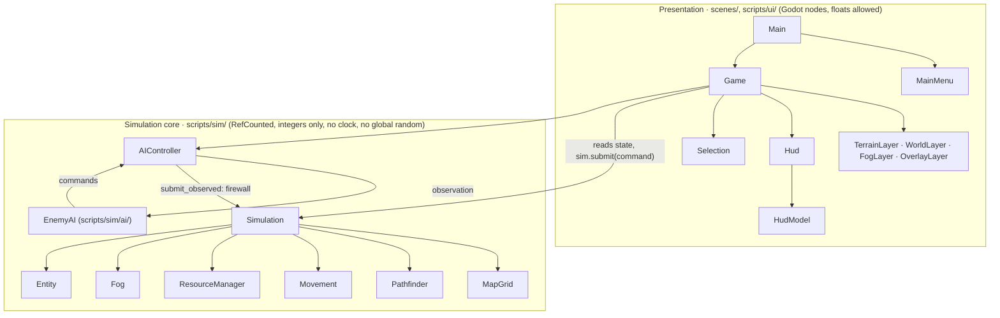

# Architecture (AC-91)

The game has **two layers** (SPEC section 6). The simulation core owns every rule; the presentation layer draws and turns input into commands.



## Rules of the two layers

| | Simulation core (`scripts/sim/`) | Presentation (`scripts/ui/`, `scenes/`) |
| --- | --- | --- |
| Base class | `RefCounted` only | Godot nodes and controls |
| Numbers | Integers only: milli-cells, ticks, squared distances | Floats for drawing (positions are converted only to draw) |
| Time | Fixed ticks, advanced by `step()` | Real time, turned into ticks by `TickClock` |
| Randomness | Its own seeded `SimRng` | Free (the menu's suggested seed) |
| Changes state? | Yes, only through `step()` and `submit()` | Never; it reads, and sends commands |
| Checked by | `test_ac_02_static_check_no_global_random_or_clock`, determinism and replay tests | Headless logic tests and screenshots |

## Which module owns each rule

| Rule (SPEC) | Module | Key functions |
| --- | --- | --- |
| Fixed 20 Hz tick, the order of work inside a tick (D-30) | `simulation.gd` | `step()` |
| Command validation order and result codes (6.2, D-27) | `simulation.gd` | `submit()`, `_apply()` |
| State hash, determinism (AC-01 to AC-03) | `simulation.gd`, `state_hasher.gd`, `sim_rng.gd` | `state_hash()`, `SimRng` |
| Map files and validation (8, AC-08) | `map_grid.gd` | `MapGrid.from_dict()` |
| Cell ↔ milli-cell ↔ pixel conversion (4, AC-09) | `map_grid.gd` | `cell_center()`, `milli_to_cell()` |
| Symmetric map generation (AC-10, AC-11) | `map_generator.gd` | `MapGenerator.generate()` |
| Unit and building stats (AC-05) | `unit_stats.gd` + `data/units.json` | `UnitStats.load_file()` |
| A* pathfinding, nearest-goal BFS (5.2, AC-12 to AC-18) | `pathfinder.gd` | `find_path()`, `find_path_to_any()` |
| Movement along paths, re-planning (AC-19, AC-25) | `movement.gd`, `simulation.gd` | `Movement.advance()`, `_replan_blocked_paths()` |
| The one resource transaction, the ledger (5.3, AC-32, AC-33) | `resource_manager.gd` | `spend()`, `refund()`, `balanced()` |
| Harvesting, drop-off, depletion (5.3, AC-29 to AC-31) | `simulation.gd` | `_tick_harvest()`, `_start_dropoff()`, `_find_replacement()` |
| Placement, construction (5.4, AC-36 to AC-38) | `simulation.gd` | `placement_check()`, `_cmd_build()`, `_tick_buildings()` |
| Production queues, spawning (5.4, AC-39 to AC-42) | `simulation.gd` | `train_check()`, `_cmd_train()`, `spawn_cells()` |
| Combat, removal of the dead, auto-acquire (5.5, AC-43 to AC-50) | `simulation.gd` | `_resolve_combat()`, `_remove_dead()`, `_auto_acquire()`, `destroy_entity()` |
| End of match (5.7, AC-51, AC-52) | `simulation.gd` | `_check_match_end()`, `_end_match()` |
| Fog of war, ghosts (5.6, AC-54 to AC-58) | `fog.gd` | `Fog.update()`, `reveal()`, `_remember()` |
| What a faction may know (7.2) | `simulation.gd`, `observation.gd` | `observation()` |
| The AI state machine (7.1, AC-62 to AC-67) | `ai/enemy_ai.gd`, `ai/ai_config.gd` | `next_state()`, `decide()` |
| The observation firewall (7.2, AC-59 to AC-61) | `ai_controller.gd`, `simulation.gd` | `before_step()`, `submit_observed()` |
| Invariants and conservation (AC-06, AC-07) | `invariants.gd` | `Invariants.check()` |
| Replays (8, AC-04) | `replay.gd` | `to_jsonl()`, `play()`, `apply()` |
| Headless matches, the experiment (16, AC-68) | `match_runner.gd`, `experiment.gd` | `MatchRunner.run()`, `Experiment.run_batch()` |
| Wilson interval, sign test (AC-70) | `scripts/analysis/stats.gd` | `Stats.wilson()` |
| Selection and context orders (9, AC-21 to AC-23) | `ui/selection.gd` | `click()`, `box()`, `context_commands()` |
| HUD contents, disabled-button reasons (AC-35, AC-73) | `ui/hud_model.gd`, `ui/hud.gd` | `train_button()`, `build_button()` |
| Camera clamping and edge pan (AC-76) | `ui/camera_math.gd`, `ui/game.gd` | `clamp_center()`, `edge_direction()` |
| Message fading (AC-73) | `ui/message_log.gd` | `entries()` |
| Main menu, restart, demo playback (AC-53, AC-74, AC-93) | `ui/main.gd`, `ui/main_menu.gd`, `ui/game.gd` | `start_match()`, `restart()` |

## One tick

```
step():
  re-plan paths blocked by new buildings
  auto-acquire (idle soldiers pick an enemy in their vision)
  combat: choose attackers on the start-of-tick state, then apply damage in id order
  units in id order: move / harvest / build / attack
  buildings in id order: construction progress, production countdown and spawning
  remove the dead (clearing every reference to them)
  end-of-match check (no HQ left -> defeat; both -> draw)
  tick += 1; timeout at the match limit
  every 5 ticks: recompute fog of war and the memory of enemy buildings and nodes
```

The AI and the player act *between* ticks: `AIController.before_step()` (every 10 ticks) and the UI both call `submit()` before `step()`. That order is recorded in the command log, which is all a replay needs.

## Determinism

Every value in the simulation is an integer; the only random source is `SimRng`, seeded from the match seed; entities live in a dictionary filled in increasing id order, so every loop runs in id order. The same map, seed and commands therefore give the same `state_hash()` on every machine, which the determinism (AC-03), replay (AC-04) and restart (AC-53) tests check.
